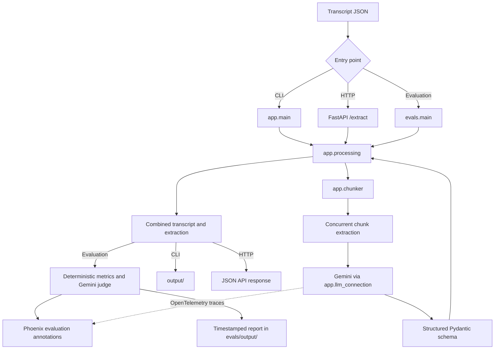

# Architecture

Action Extractor accepts one diarized transcript and returns its original fields with extracted decisions, action items, and follow-ups. It currently supports Gemini through the Google GenAI SDK.

## Runtime flow

## Transcript and extraction

Input JSON contains a `segments` list. Each segment must be an object with `speaker`, `start`, `end`, and non-empty string `text` fields. The chunker preserves all transcript metadata and splits the ordered segment list at segment boundaries. Chunks target 12,000 characters measured on compact JSON; a single oversized segment remains intact.

`app.processing` extracts chunks concurrently using `LLM_MAX_CONCURRENCY`. Each extraction run has a rolling-window request limiter configured by `LLM_REQ_PER_MINUTE` (or legacy `LLM_REQUESTS_PER_MINUTE`). Gemini server errors and HTTP 408/429 errors are retried up to `LLM_MAX_RETRIES` with exponential backoff. Results are combined into three arrays:

- `decisions`
- `action_items`
- `follow_ups`

Each item is validated with the `GroundedItem` Pydantic schema: description, optional owner and due date, exact quote, speaker, start, and end. The CLI writes the source transcript plus those arrays to `output/<input-name>`. The API returns the same shape in its response.

## Entry points

### CLI extraction

`python -m app.main [input]` calls `app.processing.process_file`. The default input is `input_data/input2.json`; the default destination is `output/`. `--model` overrides `GEMINI_MODEL_NAME`, and `--max-chars` changes the chunk target.

### HTTP API

`app.api` exposes:

- `GET /health`
- `POST /extract`

The API chunks and validates the transcript before sending it to the shared processing layer. It returns HTTP 422 for invalid segment structure, 503 when LLM configuration is missing, and 502 when extraction fails. The response preserves transcript fields alongside the three extraction arrays.

### Evaluation runner

`python -m evals.main [input]` evaluates an already-extracted file as-is. If the input has no extraction arrays, it first runs extraction and saves it under `eval_output/`. The default input is `output/input1.json`.

The runner executes three deterministic metrics (`valid_json_schema`, `valid_timestamps`, and `quote_grounding`) and the Gemini `actionability` judge. It creates one `evals/output/evaluations_<UTC timestamp>.json` report per run. The report contains the input path and transcript once, plus expected guidance and a `metrics` array. Each result includes evaluator type, name, score, label, explanation, and Phoenix span ID. `EVAL_OUTPUT_DIR` changes the report directory.

## LLM configuration

`app.llm_connection.settings` loads `.env` values without overriding process environment variables. The provider factory currently accepts `LLM_PROVIDER=gemini` and creates the Gemini wrapper. Required configuration is `GEMINI_API_KEY`; `GEMINI_MODEL_NAME` defaults to `gemini-2.5-flash`.

Relevant request settings are `LLM_MAX_CONCURRENCY`, `LLM_MAX_RETRIES`, and `LLM_REQ_PER_MINUTE`. The request limiter is created per transcript extraction, not shared globally across separate API requests or processes.

